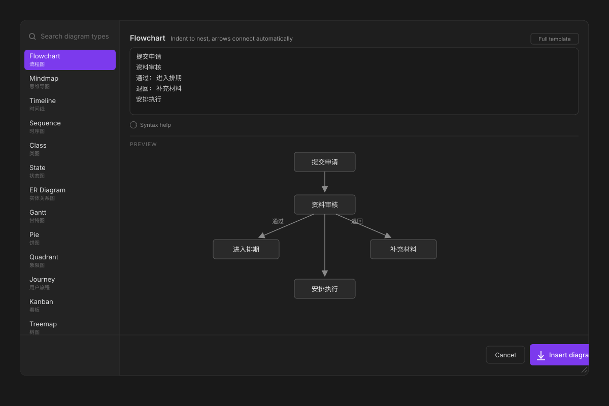
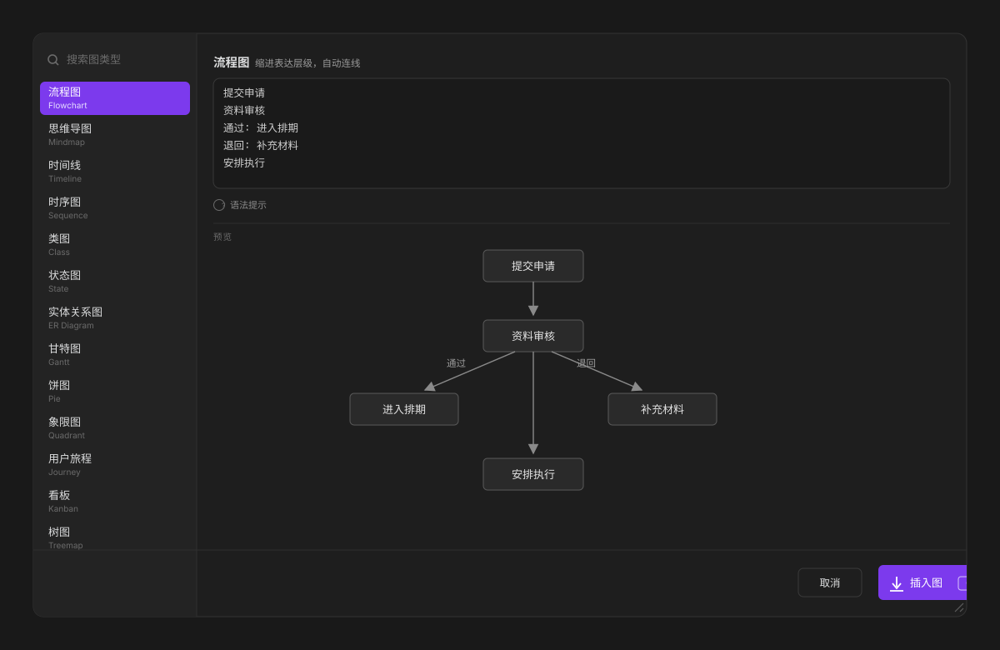
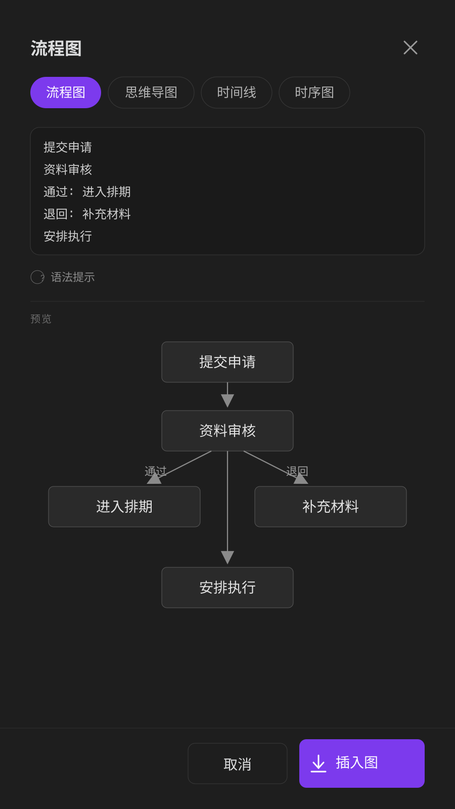

# Merchart

An Obsidian plugin that makes Mermaid diagrams practical: write plain lines, watch them render, insert in one click.

- **Write Mermaid without the syntax.** One line per node, indentation for nesting, live preview while you type. 22 diagram types, all of them.
- **Chinese input gets extra handling.** If you write Chinese, identifiers are generated for you, full-width punctuation is normalized, and your text stays as labels. The parser errors Chinese usually causes cannot happen.
- **Ready for Obsidian 1.15 and Pele.** Diagrams render through Pele, Obsidian's new renderer, and the preview follows automatically. No setting to change.

**中文说明见 [README.zh.md](README.zh.md)**

## Features

- **22 diagram types**, covering everything Obsidian's renderer supports
- **Built for Chinese input**: identifiers are generated for you, full-width punctuation is normalized, labels keep your text
- **Live preview** while you type
- **Seven commands**: one general inserter plus one per common type, all bindable to hotkeys
- **Tab indents**, Shift+Tab outdents, selection-aware block indent
- **Resizable dialog** with zoomable preview (Ctrl/Cmd + wheel, double-click to reset), remembered as a share of the window so it survives a monitor change
- **Bilingual UI**, follows Obsidian's language setting
- **Reverse editing**: put the cursor inside an existing diagram and Merchart turns it back into the structured input (flowchart, sequence, pie, timeline, mindmap)
- **Takes your selection**: select text in the note, open the dialog, it lands in the input box
- **Fills an existing block**: with the cursor inside an open ```` ```mermaid ```` fence, it inserts only the body

## Screenshots

The interface follows Obsidian's language setting. Same layout either way.





On a phone the dialog goes full screen and the type list becomes a horizontal strip:



## Why it is Chinese-friendly

Mermaid's parser requires ASCII identifiers. Three failures hit Chinese users constantly:

| What you type | What Mermaid says |
|---|---|
| `branch 内容线` in a Git graph | `Lexical error: Unrecognized text` |
| `医生，门诊，60` in a Sankey diagram | `Expecting 'COMMA', got 'NON_ESCAPED_TEXT'` |
| `text: 所有发布内容需经审核` in a requirement | `Lexical error` |

Merchart handles all three before the parser ever sees the text:

1. **Identifiers become ASCII.** Nodes, branches, entities and axes get `n1`, `p1`, `t1` style ids; your Chinese goes into the label.
2. **Full-width punctuation is folded.** `，` `：` `；` `（）` `【】` `｜` and friends are converted first.
3. **Quotes and brackets inside labels are escaped**, so a label containing `"` or `[` cannot truncate the statement.

You write what you mean; the plugin produces what the parser accepts.

## Install

Not in the community store yet. Manual install:

1. Download `main.js`, `manifest.json` and `styles.css` from the latest release.
2. Drop them into `<vault>/.obsidian/plugins/merchart/`.
3. Enable **Merchart** under Settings → Community plugins.

## Usage

Open the inserter from the command palette (**Insert diagram**), the editor right-click menu, or one of the per-type commands. Pick a type on the left, type in the middle, watch it render underneath.

| Key | Action |
|---|---|
| `Ctrl` / `Cmd` + `Enter` | Insert |
| `Tab` | Indent, or indent every selected line |
| `Shift` + `Tab` | Outdent |
| Drag bottom-right corner | Resize the dialog |

## Diagram types

Sixteen take structured Chinese input; six are editable templates because their syntax is declarative.

| Type | Input format |
|---|---|
| Flowchart | indented lines, `name{}` for decisions, `label: name` for edge labels |
| Mindmap | indented lines, first line is the root |
| Timeline | `time : event` |
| Sequence | `A > B : message` |
| Class | `Name: member, member`, then `A > B : label` |
| State | `A > B : trigger`, `[*]` for start and end |
| ER diagram | `Entity: field, field`, then `A > B : label` |
| Gantt | `task \| start \| duration`, `after some task` works |
| Pie | `item : value` |
| Quadrant | `x: low --> high`, `y: low --> high`, then `Name: 0.7, 0.3` |
| Journey | `section: name`, then `action: score` |
| Kanban | columns at the margin, cards indented |
| Treemap | root first, then `name: value` |
| Radar | `axes: a, b, c`, then `Serie: 1, 2, 3` |
| Sankey | `source > target : value` |
| XY chart | `x: ...`, `y: ...`, `type: bar` or `line` |
| Git graph, C4, Requirement, Block, Packet, Architecture | editable templates |

## Settings

| Setting | Default | What it does |
|---|---|---|
| Default diagram on open | Remember last | Follow the last type you used, or pin one |
| Indent width | 2 spaces | Spaces inserted by Tab |
| Close after inserting | On | Turn off to keep drawing in the same dialog |
| Add blank lines around the block | On | Keeps the fence from sticking to surrounding text |
| Live preview | On | Turn off for manual refresh on heavy diagrams |

## Compatibility

Obsidian 1.4 or newer. On 1.15 and later Mermaid blocks render through Pele, Obsidian's own renderer, and the preview follows automatically. The plugin does not depend on which renderer is in use.

Works on desktop and mobile. On narrow screens the dialog goes full screen, the type list turns into a horizontal strip at the top, and the drag handle is hidden since there is no pointer.

## Known limits

- Six types are templates you edit directly rather than structured forms.
- Reverse editing covers five types; the rest open as raw code in the input box.

## Development

```bash
npm install
npm run build          # typecheck + bundle to main.js
npm test               # 22 diagram types plus 18 edge cases, rendered through Pele
```

Every generated diagram is rendered through `pele` during tests, so a syntax regression fails the build instead of showing up as a broken diagram in your vault.

## License

MIT
