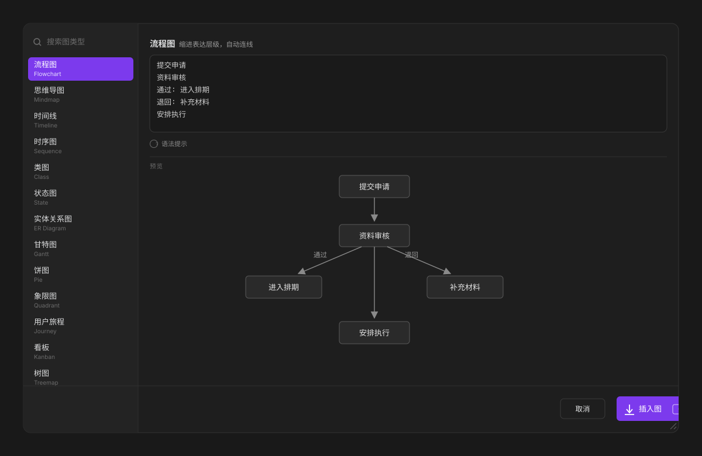
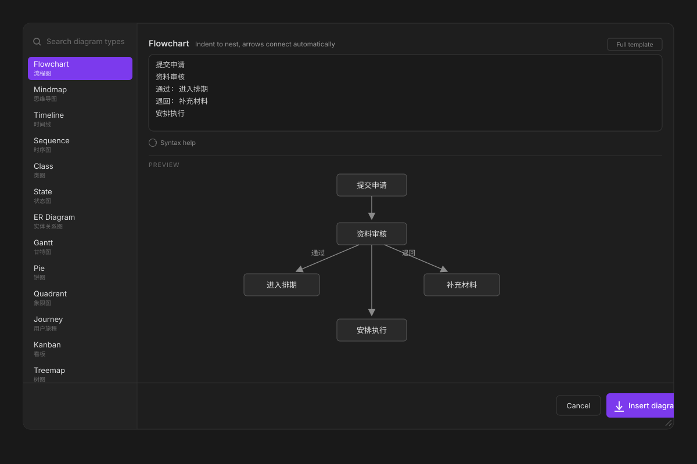
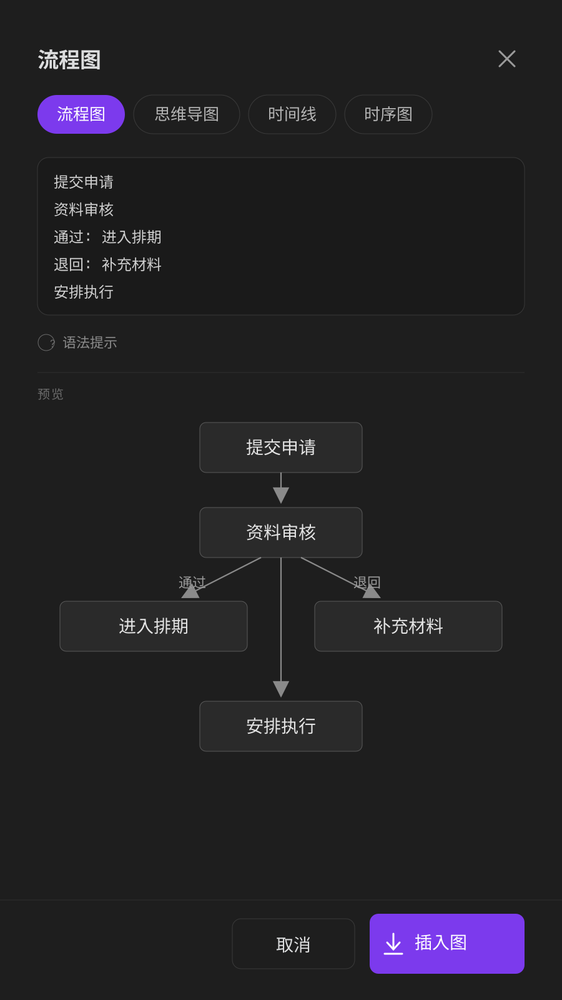

# Merchart

一个 Obsidian 插件，让 Mermaid 图真正好用：写几行字，实时看到图，一键插进笔记。

- **不用记 Mermaid 语法**。一行一个节点，缩进表达层级，边打字边出图。22 种图全覆盖。
- **写中文的话另有照顾**。标识符自动生成、全角标点自动归一、中文全部作为标签保留。中文输入常撞的那几类解析报错不会发生。
- **适配 1.15 的 Pele**。图由 Pele 渲染，预览自动跟随，不需要任何设置。

**English version: [README.md](README.md)**

## 功能

- **22 种图类型**，覆盖 Obsidian 渲染器支持的全部
- **每种图都备了一份完整模板**：形状、分组、样式、注释、关系类型都摆出来，要加东西时照着改，不用回头查语法
- **为中文输入而做**：标识符自动生成、全角标点自动归一、你的中文全部作为标签保留
- **实时预览**，边打字边出图
- **七个命令**：一个通用插入入口，常用的六种各有一个，都能绑定快捷键
- **Tab 缩进**，Shift+Tab 反缩进，选中多行整块移动
- **弹窗可拖拽调节大小**，预览可缩放（Ctrl/Cmd + 滚轮，双击重置），尺寸按窗口比例记住
- **中英双语界面**，跟随 Obsidian 的语言设置
- **反向编辑**：光标停在已有的图里打开插件，会把代码解回结构化输入（流程图、时序图、饼图、时间线、思维导图）
- **在代码块里直接改**：光标停进已有的图，开头那行右侧出现铅笔按钮，点一下就接着改，不用记命令
- **直接吃选中内容**：在笔记里选中一段文字，打开弹窗就已在输入框里
- **能填进已有的块**：光标停在未闭合的 ```` ```mermaid ```` 里时，只插入正文，不重复套围栏

## 界面

界面跟着 Obsidian 的语言设置走，两套布局一致。





手机上弹窗占满屏幕，类型列表变成顶部横向标签条：



## 为什么对中文友好

Mermaid 的解析器要求标识符是 ASCII。中文用户几乎每天都会撞上这三类报错：

| 你写的 | Mermaid 报的 |
|---|---|
| Git 图里的 `branch 内容线` | `Lexical error: Unrecognized text` |
| 桑基图里的 `医生，门诊，60` | `Expecting 'COMMA', got 'NON_ESCAPED_TEXT'` |
| 需求图里的 `text: 所有发布内容需经审核` | `Lexical error` |

Merchart 在解析器看到这些内容之前就把问题处理掉了：

1. **标识符转成 ASCII**。节点、分支、实体、坐标轴自动拿到 `n1`、`p1`、`t1` 这样的 id，你的中文进标签。
2. **全角标点归一**。`，` `：` `；` `（）` `【】` `｜` 这些先转成半角。
3. **标签里的引号和方括号做转义**，所以标签中出现 `"` 或 `[` 不会把语句截断。
4. **整段代码再过一道全角检查**。模板里的语法位若混进 `，` `：` `（）`（引号里的文字不算），插入前会换成半角并提示。

有一条例外要说明：**桑基图的节点名必须是 ASCII**。Obsidian 1.15 的渲染器只把可打印 ASCII 当作合法单元格，中文节点名（哪怕加引号）都会让整张图解析失败。插件检测到中文时会提示，改用英文、拼音或流程图。

你写你习惯的，插件负责让解析器接受。

## 安装

还没上社区插件市场。手动安装：

1. 从 release 下载 `main.js`、`manifest.json`、`styles.css`
2. 放进 `<库目录>/.obsidian/plugins/merchart/`
3. 在「设置 → 第三方插件」里启用 Merchart

## 使用

命令面板搜「插入图」，或者在编辑器里右键，也可以用各类型自己的命令。左侧选类型，中间填内容，下面实时预览。

改已有的图不用调命令：把光标点进 mermaid 代码块，开头那行右侧会浮出铅笔按钮，点它直接进编辑。光标离开块按钮就消失。

| 按键 | 作用 |
|---|---|
| `Ctrl` / `Cmd` + `Enter` | 插入 |
| `Tab` | 缩进，选中多行时整块缩进 |
| `Shift` + `Tab` | 反向缩进 |
| 拖右下角 | 调整弹窗大小 |

## 图类型

16 种是结构化输入，6 种本身就是可编辑模板，因为它们的语法是声明式的。结构化输入的那 16 种，标题右侧有「完整模板」按钮，一键切成整段 Mermaid 代码，写完的复杂写法再改回去也不丢。

| 类型 | 写法 |
|---|---|
| 流程图 | 缩进行，`名称{}` 画判断框，`标签: 名称` 给连线加字 |
| 思维导图 | 缩进行，第一行当根 |
| 时间线 | `时间 : 事件` |
| 时序图 | `甲 > 乙 : 消息` |
| 类图 | `类名: 属性, 属性`，再写 `甲 > 乙 : 关系` |
| 状态图 | `甲 > 乙 : 触发条件`，`[*]` 是起点和终点 |
| 实体关系图 | `实体: 字段, 字段`，再写 `甲 > 乙 : 关系` |
| 甘特图 | `任务 \| 开始 \| 工期`，支持 `after 某任务` |
| 饼图 | `项目 : 数值` |
| 象限图 | `x轴: 低 --> 高`、`y轴: 低 --> 高`，再写 `名称: 0.7, 0.3` |
| 用户旅程 | `section: 名称`，再写 `动作: 分数` |
| 看板 | 顶格写列名，缩进写卡片 |
| 树图 | 第一行是根，下面写 `名称: 数值` |
| 雷达图 | `轴: A, B, C`，再写 `方案: 1, 2, 3` |
| 桑基图 | `来源 > 去向 : 数值` |
| XY 图 | `x: ...`、`y: ...`、`类型: 柱状` 或 `折线` |
| Git 图、C4、需求图、块图、数据包图、系统架构图 | 可编辑模板 |

## 设置

| 设置项 | 默认 | 说明 |
|---|---|---|
| 打开时默认选中 | 记住上次 | 跟着最近用的类型走，也可以钉死某一种 |
| 缩进宽度 | 2 个空格 | 按 Tab 插入几个空格 |
| 插入后关闭弹窗 | 开 | 关掉后可以留在弹窗里连画几张 |
| 插入时自动补空行 | 开 | 避免代码块和正文黏在一起 |
| 实时预览 | 开 | 图很复杂时可以关掉，改手动刷新 |

## 兼容性

Obsidian 1.4 及以上。1.15 之后 Mermaid 块由 Pele 渲染，预览会自动跟随，插件不依赖具体渲染器。

桌面和移动端都能用。窄屏下弹窗占满屏幕，类型列表变成顶部横向标签条，拖拽手柄自动隐藏。

## 已知限制

- 6 种类型只有代码模板，没有结构化表单（其余 16 种可以切过去）
- 桑基图的节点名只支持 ASCII，中文节点名画不出来，这是渲染器的限制
- XY 图不支持数据标签，要看准确数值请另附表格
- 反向编辑覆盖 5 种，且只在能原样还原时启用：带子图、样式或注释的代码会直接按代码编辑，不会被悄悄简化

## 开发

```bash
npm install
npm run build          # 类型检查 + 打包出 main.js
npm test               # 22 种图 + 18 个边界用例 + 22 份完整模板，全部经 Pele 渲染验证
```

测试会把每一段生成的代码真的丢给 `pele` 渲染，所以语法退化会让构建失败，而不是等你打开笔记才发现图坏了。

## 许可证

MIT
